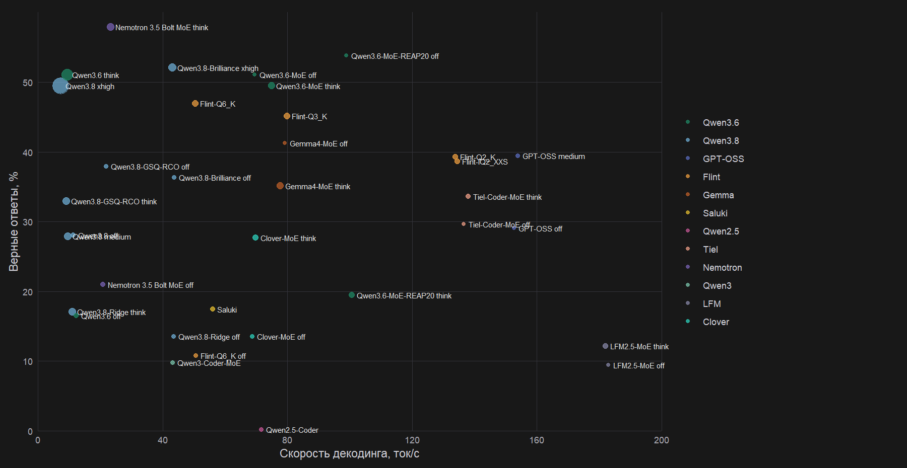

# Local DS-1000 runs

GGUF models on an RTX 4070 Ti Super (16 GB) and 32 GB of RAM. Models larger than VRAM ran one at a time with `--fit`. Generation is `run_openai.py` against the OpenAI-compatible `/v1`; scoring is `test_ds1000.py`.

Three iterations. The first: seven models on all 1000 tasks, thinking off, temperature 0, `max_tokens` 1024, stop on `</code>`. The second: Scipy, Sklearn, Numpy, and Pytorch (509 tasks), thinking on, `reasoning_effort=medium` for Qwen3.8 and Ridge, a cap of 4096, and the code stop removed. The third: the same Qwen3.8 and the same slice, `reasoning_effort=xhigh`; answers with `finish_reason=length` were continued from the saved reasoning until they hit the context window. The other table rows are separate runs of that same 509 slice. Until the last xhigh step, `finish_reason=length` means the `max_tokens` cap, not the 65536 window.

The comparison server is the Unsloth build on port 8080. Clover-MoE used the `llama.cpp-clover` build. GPT-OSS used a context of 16384. Iteration 1 had two slots (`--parallel 2`); iterations 2 and 3 defaulted to four; later models used one. Thinking was turned on with `--reasoning on`. When the GGUF has an MTP head, `--spec-type draft-mtp --spec-draft-n-max 2` was added.

```text
C:\Users\user\.unsloth\llama.cpp\build\bin\Release\llama-server.exe -m <gguf> --alias <name> -c 65536 --fit on -ctk q4_0 -ctv q4_0 --jinja --host 127.0.0.1 --port 8080 --reasoning off
```

## Accuracy and speed

Each point is a finished run on the 509 slice. The X axis is mean generation speed in tok/s; for a composite run it is weighted by completion tokens. The Y axis is the share of correct answers. Point size is wall time.



## Results

Rates and times are from the 509 slice. For Qwen3.8, the thinking-on column is the medium run. The Qwen3.8-xhigh row is the same file: thinking off matches the Qwen3.8 row, thinking on is the finished chain (252/509), and the on time is the sum of every step. For Qwen3.8-Brilliance, thinking on is xhigh. For GPT-OSS, thinking on is reasoning medium. For Flint-Q6_K, thinking off is the run with a `<code>` prefill. A dash means that mode was not run. Speed is the mean gen tok/s across the modes present in the row.

| Model | File | thinking off | thinking on | tok/s | time off | time on |
|---|---|---:|---:|---:|---:|---:|
| Qwen3.6-MoE-REAP20 | [Qwen3.6-28B-REAP20-A3B-Q4_K_M.gguf](https://huggingface.co/barozp/Qwen3.6-28B-REAP20-A3B-GGUF) | 53.8% | 19.4% | 99.8 | 12 min | 5.1 h |
| Qwen3.6-MoE | [Qwen3.6-35B-A3B-UD-Q4_K_M.gguf](https://huggingface.co/unsloth/Qwen3.6-35B-A3B-GGUF) | 51.1% | 49.5% | 72.1 | 15 min | 9.3 h |
| Qwen3.8-GSQ-RCO | [Qwen3.8-27B-GSQ-RCO-IQ3_S-mtp.gguf](https://huggingface.co/ISTA-DASLab/Qwen3.8-27B-GSQ-RCO-GGUF) | 37.9% | 33.0% | 15.4 | 43 min | 12.1 h |
| Qwen3.8 | [Qwen3.8-27B-UD-Q4_K_M.gguf](https://huggingface.co/unsloth/Qwen3.8-27B-GGUF) | 28.1% | 27.9% | 10.5 | 1.6 h | 15.1 h |
| Qwen3.8-xhigh | [Qwen3.8-27B-UD-Q4_K_M.gguf](https://huggingface.co/unsloth/Qwen3.8-27B-GGUF) | 28.1% | 49.5% | 9.3 | 1.6 h | 152.6 h |
| Qwen3.6 | [Qwen3.6-27B-UD-Q4_K_XL.gguf](https://huggingface.co/unsloth/Qwen3.6-27B-MTP-GGUF) | 16.5% | 51.1% | 10.8 | 1.6 h | 53.7 h |
| Qwen3.8-Ridge | [Qwen3.8-27B-Ridge-3.7bpw.gguf](https://huggingface.co/empero-ai/Qwen3.8-27B-Ridge-GGUF) | 13.6% | 17.1% | 27.2 | 36 min | 11.7 h |
| Qwen3.8-Brilliance | [Qwen3.8-27B-Turbo-Brilliance-50X-RI-GSQ-RCO-IQ3_S-mtp.gguf](https://huggingface.co/DavidAU/Qwen3.8-27B-Turbo-Brilliance-50X-Reasoning-Instruct-NEO-MAX-MTP-GGUF) | 36.3% | 52.1% | 43.4 | 23 min | 18.5 h |
| Qwen3-Coder-MoE | [Qwen3-Coder-30B-A3B-Instruct-Q4_K_M.gguf](https://huggingface.co/unsloth/Qwen3-Coder-30B-A3B-Instruct-GGUF) | 9.8% | — | 43.1 | 53 min | — |
| GPT-OSS | [gpt-oss-20b-Q8_0.gguf](https://huggingface.co/unsloth/gpt-oss-20b-GGUF) | 29.1% | 39.5% | 153.2 | 9 min | 38 min |
| Flint-IQ2_XXS | [flint-UD-IQ2_XXS.gguf](https://huggingface.co/unsloth/flint-GGUF) | — | 38.7% | 134.4 | — | 3.6 h |
| Flint-Q2_K | [flint-UD-Q2_K_XL.gguf](https://huggingface.co/unsloth/flint-GGUF) | — | 39.3% | 133.8 | — | 3.1 h |
| Flint-Q3_K | [flint-UD-Q3_K_XL.gguf](https://huggingface.co/unsloth/flint-GGUF) | — | 45.2% | 79.9 | — | 7.3 h |
| Flint-Q6_K | [flint-UD-Q6_K_XL.gguf](https://huggingface.co/unsloth/flint-GGUF) | 10.8% | 47.0% | 50.5 | 28 min | 8.2 h |
| Gemma4-MoE | [gemma-4-26B-A4B-it-UD-Q4_K_M.gguf](https://huggingface.co/unsloth/gemma-4-26B-A4B-it-GGUF) | 41.3% | 35.2% | 78.4 | 17 min | 9.2 h |
| Saluki | [Underdog-Saluki-27B-1.0-IQ2-mix.gguf](https://huggingface.co/ConwayResearch/Underdog-Saluki-27B-1.0) | — | 17.5% | 56.0 | — | 2.0 h |
| Tiel-Coder-MoE | [Tiel-Coder-35B-A3B-MTP-UD-IQ3_S.gguf](https://huggingface.co/peculiar-ragdoll/Tiel-Coder-35B-A3B-GGUF-MTP) | 29.7% | 33.6% | 137.2 | 6 min | 1.9 h |
| Nemotron 3.5 Bolt MoE | [NVIDIA-Nemotron-3.5-Bolt-74B-A9B-UD-Q3_K_XL.gguf](https://huggingface.co/unsloth/NVIDIA-Nemotron-3.5-Bolt-74B-A9B-GGUF) | 21.0% | 58.0% | 22.1 | 1.7 h | 14.4 h |
| LFM2.5-MoE | [LFM2.5-24B-A2B-UD-Q4_K_XL.gguf](https://huggingface.co/unsloth/LFM2.5-24B-A2B-GGUF) | 9.4% | 12.2% | 182.4 | 10 min | 3.3 h |
| Clover-MoE | [Diffuspace-Clover-35B-A3B-Preview-Q4_K_M.gguf](https://huggingface.co/maternion/Clover-35B-A3B-Preview-GGUF) | 13.6% | 27.7% | 69.2 | 19 min | 5.4 h |
| Qwen2.5-Coder | [Qwen2.5-Coder-7B-Instruct-Q8_0.gguf](https://huggingface.co/unsloth/Qwen2.5-Coder-7B-Instruct-128K-GGUF) | 0.2% | — | 71.5 | 23 min | — |
